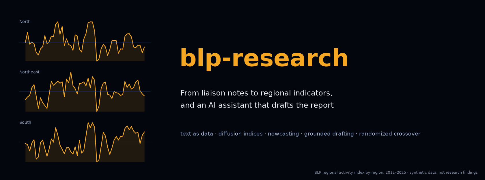

<p align="center"><a href="paper/main.pdf"></a></p>

<p align="center">
<a href="https://github.com/thanatchon36/blp-research/actions/workflows/ci.yml"></a>
<a href="pyproject.toml"></a>
<a href="https://thanatchon36.github.io/blp-research/paper/"></a>
<a href="paper/main.pdf"></a>
<a href="#going-from-synthetic-to-real"></a>
<a href="LICENSE"></a>
<a href="https://zenodo.org/badge/latestdoi/1452378722"></a>
<a href="https://huggingface.co/datasets/thanatchon36/blp-research"></a>
</p>

<p align="center">
📖 <b><a href="https://thanatchon36.github.io/blp-research/paper/">Read the paper online</a></b> ·
📄 <b><a href="paper/main.pdf">Download the PDF</a></b> ·
🧪 <b><a href="run_pipeline.py">Pipeline</a></b> ·
🤗 <b><a href="https://huggingface.co/datasets/thanatchon36/blp-research">Dataset</a></b> ·
📝 <b><a href="CHANGELOG.md">Changelog</a></b> ·
📚 <b><a href="CITATION.cff">Cite</a></b>
</p>

**Text-based measurement of regional economic activity from the Bank of Thailand's Business Liaison Program (BLP)
and a randomized evaluation of a generative-AI report-drafting assistant.** The code turns Thai-language interview
notes into sector-weighted, composition-adjusted regional indicators, tests them in pseudo-real-time nowcasts, drafts
regional reports with an assistant that cites a source for every sentence and blocks numbers it cannot verify, and
designs the randomized crossover experiment that tests whether the assistant cuts preparation time by more than 20%.

> **Synthetic data notice.** BLP data are confidential and are not part of this repository. Everything here runs on
> a synthetic data generator (`src/blp/synthetic.py`); the numbers it produces verify the software and are not
> research findings. `data/` and `.env` are excluded by `.gitignore`: never commit notes or API keys.

## Install and quickstart

```bash
make setup      # uv venv + dependencies (Python 3.12)
make all        # pipeline -> figures -> paper   (a few minutes)
make test       # smoke tests
```

Outputs: `outputs/` (reliability, indicators, nowcast evaluation, verifier report, power curve, experiment dry run,
`summary.json`), `paper/figures/` and `paper/numbers.json` (generated), `paper/main.pdf`, `docs/paper/`.

| Target | Purpose |
|---|---|
| `pipeline` | All four studies end to end on synthetic data → `outputs/`; pass LLM options with `ARGS="..."` |
| `figures` | Every data-driven figure and number in the paper → `paper/figures/`, `paper/numbers.json` |
| `paper` | Compile `paper/main.pdf` (tectonic) and rebuild the web reader `docs/paper/` |
| `web` | Web reader only → `docs/paper/index.html`, served at <https://thanatchon36.github.io/blp-research/paper/> (pandoc, tectonic, poppler) |
| `arxiv` | arXiv source bundle → `paper/arxiv.tar.gz` (prints title, abstract and comments for the form) |
| `dataset` | Hugging Face dataset → `dataset/` (synthetic notes, labels, series and results), uploaded to [`thanatchon36/blp-research`](https://huggingface.co/datasets/thanatchon36/blp-research) |
| `banner` | README banner → `docs/assets/banner.png` |

## What the pipeline does

1. **Anonymization** (`blp.preprocess`): firm and contact names from the contact database are masked before any
   scoring; the pipeline counts identifiers left after masking and the verifier rejects any that reach a draft.
2. **Study 1, measurement** (`blp.scoring`, `blp.reliability`, `blp.indicators`): a six-topic codebook (sales,
   employment, investment, price, cost, outlook) coded by a lexicon (M1), an LLM (M3) or an ensemble (M4) and scored
   against a gold standard with Cohen's kappa, Krippendorff's alpha and macro-F1; diffusion indices weighted by
   sectoral output shares and adjusted for panel composition with weighted two-way fixed effects.
3. **Study 2, validation** (`blp.nowcast`): expanding-window pseudo-real-time nowcasts of regional activity, AR
   benchmark against AR + BLP indices, Clark–West and Diebold–Mariano tests.
4. **Study 3, drafting assistant** (`blp.assistant`): hybrid retrieval over anonymized notes, a drafter that writes
   one sentence per line with a citation to a data table or a note, and a verifier that blocks unverified numbers,
   invalid citations and identifying details.
5. **Study 4, experiment** (`blp.experiment`): balanced crossover randomization, power simulation, the
   pre-registered analysis (time reduction, non-inferior blinded quality, carryover) and a time-logging format.

## Research: *From Liaison Notes to Regional Indicators*

The preprint by Thanatchon Chongmankhong is in [`paper/`](paper/): a PDF in [`paper/main.pdf`](paper/main.pdf)
and its LaTeX source in [`paper/main.tex`](paper/main.tex) with [`paper/references.bib`](paper/references.bib).
`make paper` compiles it with tectonic and renders the same text as a web page at
<https://thanatchon36.github.io/blp-research/paper/>; `make arxiv` packs the source with its figures and
bibliography into `paper/arxiv.tar.gz` and checks the bundle compiles on its own. Every data-driven figure and number comes from
`scripts/make_figures.py`, so `make figures` regenerates them all.

- Dataset on Hugging Face: [`thanatchon36/blp-research`](https://huggingface.co/datasets/thanatchon36/blp-research), with the synthetic notes (masked), gold labels,
  target series, simulated coders and experiment, and every result the pipeline computes from them

| Module | Paper section |
|---|---|
| `src/blp/preprocess.py` | 3.4 Data governance and ethics |
| `src/blp/scoring.py`, `src/blp/reliability.py` | 4.2 Scoring methods, 4.5 Validity |
| `src/blp/indicators.py` | 4.3 Index construction, 4.4 Composition adjustment |
| `src/blp/nowcast.py` | 5 Study 2 |
| `src/blp/assistant/` | 6 Study 3 |
| `src/blp/experiment/` | 7 Study 4 |
| `src/blp/synthetic.py` | 8 Proof of concept, Appendix D |

## Using an LLM

The default deployment is an on-premise open-weight model behind an OpenAI-compatible endpoint (vLLM, Ollama):

```bash
uv pip install --python .venv/bin/python -e ".[llm]"
make pipeline ARGS="--llm local --base-url http://<gpu-host>:8000/v1 --model <thai-llm>"
```

The Claude API client (`--llm anthropic`, reads `ANTHROPIC_API_KEY`) may only be used with anonymized data under an
approved data-processing agreement. Freeze model versions for the whole experiment.

## Repository layout

```
src/blp/
  synthetic.py              synthetic BLP notes, gold labels, target series
  preprocess.py             anonymization, Thai clause splitting
  scoring.py                lexicon (M1), LLM (M3), ensemble (M4) scorers
  reliability.py            Cohen's kappa, Krippendorff's alpha, macro-F1
  indicators.py             diffusion, sector-weighted, composition-adjusted indices
  nowcast.py                expanding-window evaluation, Clark-West, Diebold-Mariano
  assistant/                LLM clients, hybrid retrieval, drafter, verifier
  experiment/               crossover design, power simulation, analysis, time logs
run_pipeline.py             all four studies end to end
scripts/make_figures.py     every figure and number in the paper
scripts/build_web.py        web reader docs/paper/ from paper/main.tex
scripts/arxiv_bundle.py     arXiv source bundle
scripts/export_dataset.py   Hugging Face dataset (card in dataset_card/)
scripts/make_banner.py      README banner
scripts/make_linkedin_poster.py  LinkedIn poster (post text in docs/linkedin_post.md)
paper/                      main.tex, references.bib, figures/, numbers.json, main.pdf, reader.html
docs/                       GitHub Pages: web reader, banner, logo
tests/                      smoke tests
```

## Going from synthetic to real

Inside the secure enclave only:

1. `notes`: `note_id, firm_id, region, province, sector, quarter (pandas Period), interview_date, raw_text`.
2. `hard`: `region, quarter, y` (official target series).
3. `entities`: firm and contact names from the BLP contact database, used for masking and by the verifier.
4. Sector weights: GRP sector shares by region (`src/blp/constants.py` holds illustrative values only).

## Limitations

Synthetic data: the notes are built from templates, so the lexicon's agreement with the gold standard is an upper
bound; illustrative sector weights; a purposive BLP sample and short histories; results specific to a frozen LLM;
the experiment is designed and powered but not run. See paper §9.4.

## Citation

See [`CITATION.cff`](CITATION.cff) or the BibTeX on the [web reader](https://thanatchon36.github.io/blp-research/paper/#how-to-cite); each release is
archived on Zenodo (DOI badge above). License: MIT.
